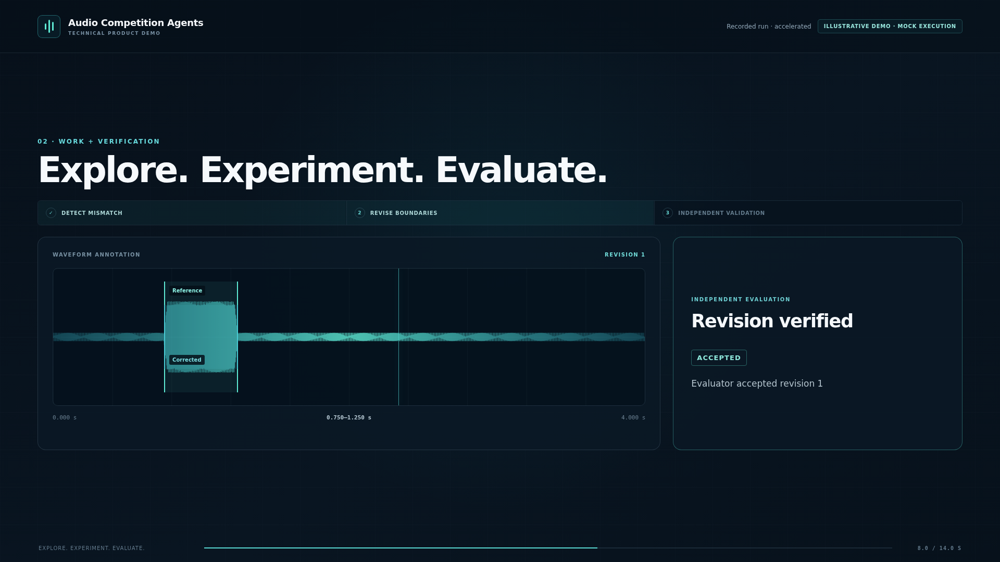
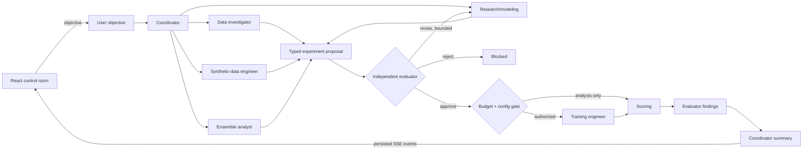

# Multi-Agent AI System for AI Hackathons

**Solving real-world ML problems with agentic swarms.**

Audio Competition Agents is a guarded, inspectable multi-agent workflow for the
IndoML/Vaani class-agnostic noise-event detection project. It coordinates
analysis and experiment decisions around existing competition code without
copying datasets, weights, private artifacts, or model implementations.

The default mode is deterministic, CPU-only, and offline. It is explicitly a
mock-agent test mode; its toy metrics are not competition results.

## Demo

The 14-second demo is driven by the bundled 35-event mock execution trace. It
shows recorded agent handoffs, an evaluator boundary finding, a corrected
artifact, independent acceptance, and workflow completion.

[Watch the 1920×1080 landscape demo](artifacts/social_highlight_v3/multi-agent-ai-hackathons-landscape.mp4)
·
[Watch the 1080×1920 vertical demo](artifacts/social_highlight_v3/multi-agent-ai-hackathons-vertical.mp4)

[](artifacts/social_highlight_v3/multi-agent-ai-hackathons-landscape.mp4)

Public repository: [ashishmokalkar/Multi-agent-system-for-AI-Hackathons](https://github.com/ashishmokalkar/Multi-agent-system-for-AI-Hackathons)

## Architecture



Every arrow is a persisted structured handoff. Specialists receive only the
objective and evidence needed for their task, so they have separate model
contexts rather than a shared mutable transcript. Independent specialist calls
run concurrently where dependencies allow. Proposal review and GPU execution
remain serialized.

## Framework choice

Real mode uses the Python **OpenAI Agents SDK**. Official OpenAI documentation
describes it as a code-first runtime for typed agents, function tools,
orchestration, handoffs, state, approvals, and tracing. That fits this project:
the application owns local tools, SQLite state, and execution approval while
the SDK owns each model loop. The SDK is feature-complete and continues to
receive maintenance, security, compatibility, and critical bug fixes.

- [OpenAI Agents SDK guide](https://developers.openai.com/api/docs/guides/agents/sdk)
- [Agents SDK quickstart](https://developers.openai.com/api/docs/guides/agents/quickstart)

The workflow uses explicit application-level typed handoffs so evaluator and
budget gates behave identically in mock and real modes. One real provider
(OpenAI) is implemented initially.

## Agents and tool boundaries

| Agent | Output schema | Allowed tools |
|---|---|---|
| Coordinator | `CoordinatorOutput` | None; delegates and summarizes |
| Data investigator | `DataInvestigationOutput` | Manifest inspection, source-split validation |
| Synthetic-data engineer | `SyntheticEngineeringOutput` | Generator policy check, one-clip generator adapter |
| Research/modeling | `ExperimentProposal` | Read-only manifest inspection |
| Training engineer | `TrainingEngineeringOutput` | Allowlisted training and inference |
| Independent evaluator | `EvaluationReview` | Split validation and scoring |
| Ensemble analyst | `EnsembleAnalysisOutput` | Prediction compatibility and scoring |

The original-project adapters resolve `AUDIO_AGENTS_ORIGINAL_REPO` explicitly
and run from this repository. They do not assume that the original project is
the current working directory. Tool provenance is recorded in `NOTICE.md`.

## Setup

```bash
cd audio-competition-agents
python3 -m venv .venv
source .venv/bin/activate
pip install -e '.[dev]'
```

Run the offline demonstration:

```bash
audio-agents --mode mock demo --scenario happy
audio-agents --mode mock inspect
```

The happy scenario performs actual structured handoffs, manifest inspection,
proposal revision after evaluator feedback, toy scoring, a second evaluator
review, persistence, and final coordination. It launches no training.

Verify fail-closed behavior:

```bash
audio-agents --mode mock demo --scenario invalid-split
audio-agents --mode mock demo --scenario unauthorized-training
```

Run the focused test suite:

```bash
pytest
```

## Real analysis-only mode

```bash
pip install -e '.[openai]'
export OPENAI_API_KEY='...'
export AUDIO_AGENTS_ORIGINAL_REPO=/path/to/existing/competition/repository
audio-agents --mode real run \
  --objective 'Audit this fixed source-disjoint manifest and draft one matched experiment' \
  --manifest /path/to/manifest.jsonl
```

The program reads environment variables directly; it does not parse `.env` or
store credentials. Without `OPENAI_API_KEY`, real mode fails before an agent
run. Mock mode makes no API calls.

## Training authorization

Training is impossible from free-form model text. The training agent can only
name a job in `configs/training_allowlist.toml`; the launcher builds the argv
list without a shell. A live job additionally requires all of:

1. `--mode real` and `--execute-training`;
2. `--authorize-training`, a positive run count, and sufficient GPU hours;
3. `--live-execution`;
4. evaluator approval;
5. catalogued device, timeout, and entry point.

One non-blocking file lock permits only one GPU job. Jobs have a timeout and a
managed cancellation hook (`audio-agents cancel RUN_ID`). Default operation is
dry-run. Submission, publishing, and git push are disabled.

## Persistence and resume

`runs/runs.sqlite3` stores objectives, budgets, messages, structured outputs,
experiment configurations, metrics, artifact references, status, and workflow
checkpoints. Inspect with `audio-agents inspect RUN_ID`; resume a non-terminal
run with `audio-agents resume RUN_ID`.

## Existing-code adapters

- Data isolation follows the established source-group, duplicate-hash, clip-ID,
  and evaluation-hash checks.
- `scorer=official` invokes the configured existing `official_metrics` function
  in an isolated worker. The bundled scorer is named `toy` and never presented
  as official.
- Synthetic generation requires sample-accurate active intervals and transform
  provenance. Center-crop/whole-crop annotation policies are rejected.
- Training and inference call only exact catalog entries.
- Ensemble inspection requires identical clip sets and frame lengths before any
  combination can be considered.

## Repository scope and licensing

This repository is MIT-licensed for its new orchestration code. See `NOTICE.md`
for original-project attribution and third-party/data boundaries. No audio,
weights, credentials, submissions, or historical private artifacts are
included. Historical claims are not generated or validated by this system.

## Experiment control room

The live demo is a React/TypeScript dashboard backed by the same Python agent
registry, tool permissions, SQLite run store, and structured outputs as the CLI.
The API streams persisted events with server-sent events (SSE); the frontend
does not contain scripted agent responses.

Build and serve the production interface:

```bash
cd audio-competition-agents
source .venv/bin/activate
pip install -e '.[dev]'
cd frontend
npm install
npm run build
cd ..
audio-agents --mode mock serve --host 127.0.0.1 --port 8765
```

Open [http://127.0.0.1:8765](http://127.0.0.1:8765). The server binds only to
loopback by default. For frontend development, keep the Python server running
and start Vite in a second terminal:

```bash
cd audio-competition-agents/frontend
npm run dev
```

Then open [http://127.0.0.1:5173](http://127.0.0.1:5173). Vite proxies `/api`
to port 8765.

The interface exposes three unambiguous modes:

- **Mock** runs deterministic offline agents with real local typed tools. It
  generates a redistributable WAV, rejects a known-bad boundary through the
  evaluator tool, performs one bounded correction, and records actual toy
  fixture scores.
- **Live** uses the OpenAI Agents SDK and is enabled only when the optional
  dependency and `OPENAI_API_KEY` are present. Tool, budget, and revision gates
  are unchanged.
- **Recorded replay** plays the bundled 35-event trace captured from an actual
  completed mock workflow. Its source mode remains visible. Pause, seek, and
  0.5×/1×/2× controls affect presentation timing only; original event
  timestamps remain in the inspector.

No audio autoplays. The waveform and spectrogram share the decoded-audio
clock, and the fixture reference is explicitly known by construction rather
than inferred from signal energy. The displayed scores are labeled toy fixture
metrics and are not historical competition results.

Run all checks:

```bash
pytest
cd frontend
npm test
npm run build
npx playwright install --with-deps chromium  # first browser-test setup only
npm run test:e2e
npm audit --audit-level=moderate
```

### Social highlight capture

The dedicated 14-second replay opens with **Multi-Agent AI System for AI
Hackathons** and **Solving real-world ML problems with agentic swarms.** It
uses only the persisted 35-event mock recording, shows the recorded evaluator
finding and accepted revision, and omits toy and historical competition scores.

- `/highlight/landscape?autoplay=1` at 1920×1080
- `/highlight/vertical?autoplay=1` at 1080×1920
- `?t=SECONDS` for a deterministic fixed frame
- Either route without capture parameters for pause/replay controls

```bash
cd frontend
npm run capture:highlight
```

The opening is limited to two seconds and uses a moving decoded waveform and
signal scan. Recorded handoffs, task labels, boundary analysis, staged
verification, and the completion trace provide the technical motion; no
invented scores or training activity are shown.

This creates separate 14.0-second H.264 MP4s and twelve representative-frame
PNGs in `artifacts/social_highlight_v3`. Versions 1 and 2 remain preserved.
See [`docs/HIGHLIGHT_REEL.md`](docs/HIGHLIGHT_REEL.md) for the verified short
storyboard and [`docs/RECORDING_STORYBOARD.md`](docs/RECORDING_STORYBOARD.md)
for the legacy long-form capture.

